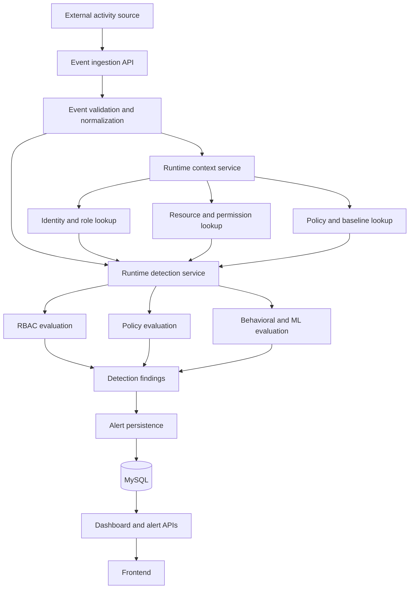

# Anomex System Architecture

## Overview

Anomex is an Intelligent SQL Access Anomaly Detection System. It combines identity and role context, resource permissions, access policies, behavioral baselines, and machine-learning analysis to identify suspicious SQL activity.

The Python backend exposes HTTP APIs. MySQL stores application identities, authorization metadata, observed activity, detection state, and alerts. A browser frontend consumes backend APIs.

## Logical architecture

This is a logical processing diagram; it does not mean Anomex is installed between database clients and the database server.

## Components

- **Frontend:** static browser application that calls backend endpoints.
- **Flask backend:** `backend/app.py` creates the application and registers route blueprints.
- **Authentication and authorization:** session and permission services resolve Anomex users and role-derived permissions. User/role administration endpoints require the Database Admin role.
- **Event ingestion:** `POST /api/ingest/events` accepts externally observed activity and is protected by `ANOMEX_INGESTION_API_KEY`.
- **Runtime detection:** loads actor, role, resource, permission, policy, and baseline context before evaluating the event.
- **Persistence:** MySQL stores identities, roles, resources, permissions, policies, sessions, query activity, baselines, alerts, and migration-added ingestion/evaluation support records.
- **ML pipeline:** `ml/` contains feature engineering and model training/evaluation utilities. Offline evaluation is distinct from runtime event ingestion.

## Trust and operational boundaries

- A producer or collection process must observe SQL activity and forward events.
- The ingestion API key authenticates the producer; it is not an end-user session or a database credential.
- Anomex analyzes submitted activity. It does not currently transparently intercept every database connection.
- An alert is an analysis result, not proof that a SQL statement was blocked.
- Detection quality depends on reliable actor identity and event/resource context.
