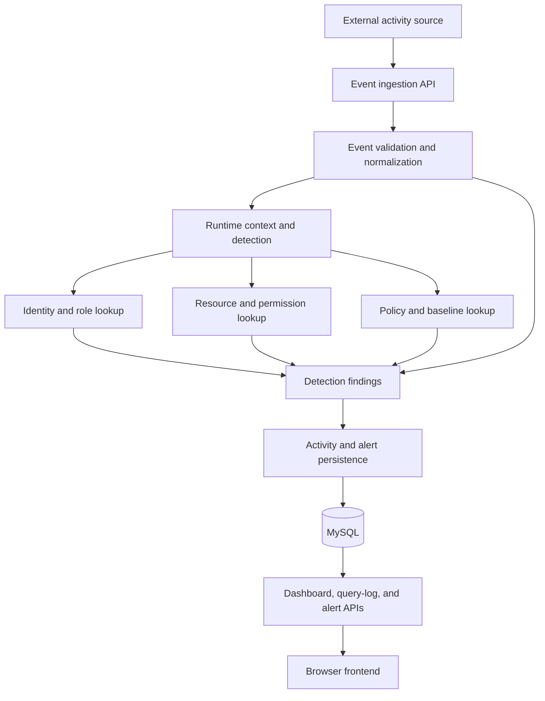

# System Architecture

## Overview

Anomex is a Python backend and browser frontend backed by MySQL. It analyzes externally observed SQL activity by combining identity and role context, resource permissions, access policies, behavioral baselines, and ML-assisted detection.

## Logical architecture

This is a logical application flow. It does not mean Anomex sits inline between a SQL client and a database server.

## Components

- **Frontend:** browser interface that consumes backend APIs.
- **Flask backend:** `backend/app.py` creates the Flask application and registers route blueprints.
- **Authentication and authorization:** session and permission services resolve Anomex users and role-derived permissions. User and role administration routes require the Database Admin role.
- **Event ingestion:** `POST /api/ingest/events` accepts events from trusted producers and uses `ANOMEX_INGESTION_API_KEY`.
- **Runtime detection:** validates events, resolves actor identity, loads authorization and policy context, and evaluates configured detection components.
- **Persistence:** MySQL stores users, sessions, roles, permissions, resources, policies, query activity, baselines, alerts, and migration-created support records.
- **ML components:** `ml/` contains feature engineering and model training/evaluation utilities. Offline workflows are distinct from runtime event processing.

## Trust boundaries

- An external producer or collection process must observe SQL activity and forward events.
- The ingestion API key authenticates a producer; it is not a user's Anomex session or a database credential.
- Anomex analyzes submitted events; it does not currently transparently intercept every database connection.
- An alert is an analysis result, not proof that the original SQL operation was prevented.
- Identity resolution and detection quality depend on actor information and configured account mappings/context.
